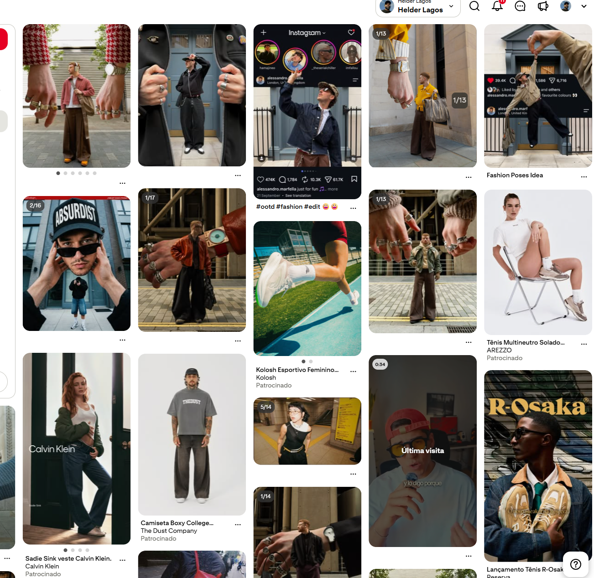
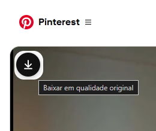
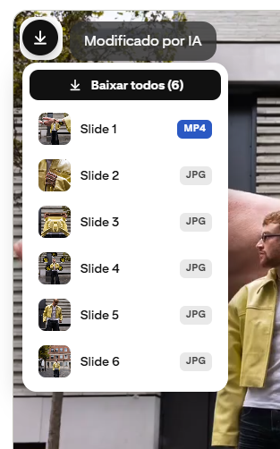

# PDBHL · Pin Downloader by HL

Extensão do Chrome que baixa imagens, GIFs e vídeos do Pinterest **com um clique**, sempre na maior qualidade disponível.

Passou o mouse no pin, apareceu a setinha. Clicou, baixou.

<p align="center">
  
</p>

---

## O que ela faz

- **Imagens na resolução original**, não a miniatura comprimida do feed
- **GIFs animados** salvos como .gif
- **Vídeos** salvos em .mp4 na maior resolução do pin
- **Carrosséis e Idea Pins** com menu por slide: baixe só o que você quer ou todos de uma vez, cada um no formato real dele (GIF, JPG, PNG ou MP4)
- **Arquivos organizados** numa pasta própria, com o título do pin no nome

Funciona no feed, nas pastas, na busca e no pin aberto, em todos os domínios do Pinterest (br.pinterest.com incluso).

---

## Como instalar

A extensão não está na Chrome Web Store, então a instalação é manual. Leva uns 2 minutos.

**1. Baixe o código**
Aqui no topo desta página, clique no botão verde **Code** e depois em **Download ZIP**.

**2. Descompacte numa pasta fixa**
Extraia o ZIP num lugar onde ele vai ficar, tipo `Documentos/Extensões/PDBHL`. Não apague essa pasta depois: o Chrome lê a extensão direto dela.

**3. Abra a página de extensões do Chrome**
Digite `chrome://extensions` na barra de endereço e aperte Enter.

**4. Ligue o Modo do desenvolvedor**
É a chavinha no canto superior direito da página.

**5. Carregue a extensão**
Clique em **Carregar sem compactação** e selecione a pasta que você descompactou (a que tem o arquivo `manifest.json` dentro).

**6. Fixe o ícone na barra**
Clique no ícone de quebra-cabeça do Chrome e no alfinete ao lado do **PDBHL**.

**7. Recarregue o Pinterest**
Se o Pinterest já estava aberto, dê um F5 pra extensão começar a funcionar.

---

## Como usar

### Pin de imagem, GIF ou vídeo

Passe o mouse em cima de qualquer pin. A setinha aparece no canto superior esquerdo.

<p align="center">
  
</p>

Um clique e pronto. O botão fica verde quando o download começa e aparece um aviso na parte de baixo da tela.

### Carrossel ou Idea Pin

Quando o pin tem mais de um slide, o clique abre um menu com a miniatura de cada um e o formato real do arquivo.

<p align="center">
  
</p>

- **Baixar todos** salva o carrossel inteiro, numerado em ordem
- **Clique num slide** pra baixar só ele
- A etiqueta mostra o formato: **MP4** em azul, **GIF** em preto, **JPG** e **PNG** em cinza

Pra fechar o menu, clique fora dele, aperte Esc ou role a página.

---

## Onde os arquivos vão parar

Por padrão em `Downloads/Pinterest/`, com nomes assim:

```
titulo-do-pin_1102959765026059543.jpg
titulo-do-pin_1102959765026059543-01.mp4   (slide 1 de um carrossel)
```

Clicando no ícone do PDBHL na barra do Chrome você pode:

- **Trocar o nome da pasta** (dá pra criar subpastas, ex: `Referências/Moda`)
- **Ligar "Perguntar onde salvar"** pra escolher o destino a cada download

Quer que os arquivos caiam em outro disco ou diretório do PC? Vá em `chrome://settings/downloads`, mude o **Local** padrão do Chrome, e a extensão cria a pasta dela lá dentro.

---

## Como atualizar

1. Baixe o ZIP novo daqui do GitHub
2. Substitua os arquivos da pasta antiga pelos novos
3. Em `chrome://extensions`, clique no ícone de recarregar do PDBHL
4. Dê F5 no Pinterest

---

## Se algo parar de funcionar

O Pinterest muda o site com frequência. A extensão tenta primeiro os dados internos do pin e, se falhar, pega a mídia direto da página.

- **Botão não aparece:** recarregue a aba do Pinterest
- **Aviso "Extensão atualizada. Recarregue a página":** dê F5
- **Download falhou:** recarregue a extensão em `chrome://extensions` e tente de novo

Algum pin específico que não baixa? Abra uma issue aqui no repositório com o link dele.

---

## Autor

Criado por [Helder Lagos](https://helderlagos.com.br).
